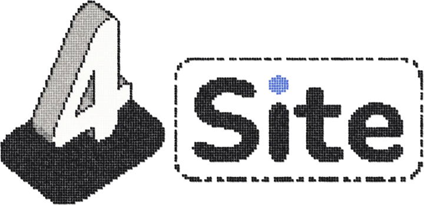
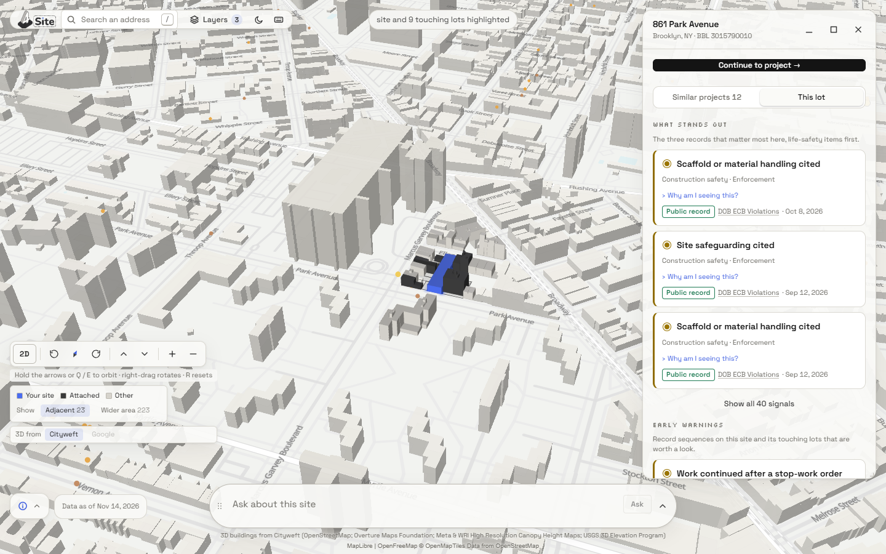
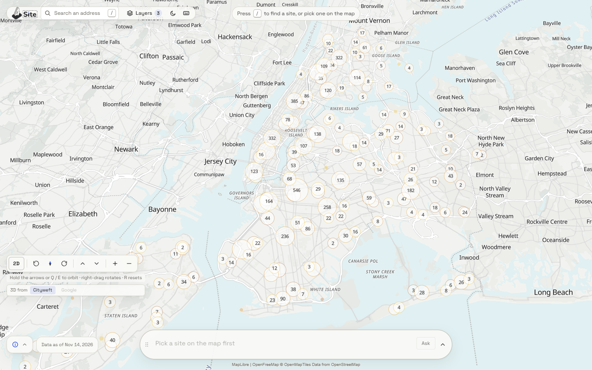

<p align="center">
  
</p>

<p align="center">
  <b>See what the public record says about a site and its neighbors, before work starts.</b><br>
  A citywide 3D map of New York for architects and structural engineers.
</p>

<p align="center">
  <a href="https://4site-nyc.vercel.app/"><b>Open the live app →</b></a>
  &nbsp;·&nbsp; Built at AEC Tech NYC 2026
</p>



## Why

When a project digs next to older buildings, the warning signs are often already public: neighbors'
311 reports, DOB complaints and violations, stop-work orders, the age and construction of the lots it
touches. They sit across a dozen city datasets, and each person on the team sees only one piece.
4site puts them on one map, for one site, with the source and date of every fact.

## What it does

| | |
|---|---|
| **City map** | Every public source as a layer (construction incidents, structural complaints, vacate orders, unsafe facades, flood zones, contamination, an excavation watchlist), each with its source, date and count. |
| **Site and neighbors** | Search an address or click a building. The map flies to it in 3D, outlines the lot and every lot that touches it, and marks which neighbors are attached. |
| **What stands out** | The records that matter most for the site and its neighbors, life-safety items first, each with "Why am I seeing this?". |
| **Similar projects** | Past cases across the city with a similar profile: what matched, what differed, and what went wrong, with the cause only as publicly reported. |
| **Early warnings** | Record sequences worth a look, such as work continuing after a stop-work order. |
| **Project checklist** | Set up the job (work type, dig depth, height, who's on the team) and get a shared checklist by discipline: who owns each check, when it's due and the proof it needs. |
| **Ask** | Ask in plain English. Every part of the answer links to the record it came from. |



## How it stays honest

- Every fact shows its source and date. A source that fails to load says so; it is never shown as zero.
- Similar cases are "compared with similar sites", never a prediction of what will happen here.
- Causes of past cases appear only as publicly reported or under investigation. No blame.
- Housing violations are not scored as structural risk, and proof is never inferred from public data.
- No names of owners, applicants, permit holders or contractors.
- **What 4site doesn't know** is on every screen: public records and reported cases only, not
  exhaustive, and not engineering advice. The licensed professionals on the project decide.

## Run it locally

Needs Python 3.12 and Node 22.

```bash
python -m venv .venv && .venv/bin/pip install -r api/requirements.txt
.venv/bin/uvicorn api.main:app --port 8000          # the API
cd web && npm install && npm run dev                # the app, at http://localhost:5173
```

With the API down, the app falls back to saved sample data and labels it "Sample data". Optional keys
stay in your environment, never in the code: `ANTHROPIC_API_KEY` (chat), `CITYWEFT_API_KEY` (3D city
model), `VITE_GOOGLE_MAPS_KEY` (Google 3D tiles), `SOCRATA_APP_TOKEN` (higher Open Data limits).

**Tests:** `.venv/bin/python -m unittest discover -s tests -t .` and `cd web && npm test && npm run build`.
**Deploying:** see [deploy/README.md](deploy/README.md).

## How it's built

- **Web:** React 19, Vite, Tailwind 4, MapLibre with deck.gl for the 3D layers and arcs, and 3D
  buildings from Cityweft or Google Photorealistic 3D Tiles.
- **API:** FastAPI with typed contracts ([api/contracts.py](api/contracts.py)) shared with the web app.
- **Data:** NYC Open Data (DOB complaints, violations, incidents and job filings; 311; PLUTO; tax lots;
  building footprints; facades; vacate orders), NYC Planning GeoSearch, FEMA and NYS DEC.

| Folder | What's in it |
|---|---|
| [web/](web/) | The app: map, layers, site panel, project and checklist screens, chat |
| [api/](api/) | The FastAPI server and the contracts |
| [city_layers/](city_layers/README.md) | Pulls citywide sources into map layers, each record tagged with a hazard and severity |
| [data_pull/](data_pull/README.md) | Address in; the public record for the site and every touching lot out |
| [site_profile/](site_profile/README.md) | The site profile and similar-case ranking |
| [lessons/](lessons/) | Past incidents tagged by how they failed and what prevents each |
| [early_warning/](early_warning/) | Early-warning rules and the excavation watchlist |
| [checklist/](checklist/README.md) and [actions/](actions/) | Building Code duties toward neighbors, and the actions by discipline |
| [foresight_model/](foresight_model/README.md) | The pattern score ([model card](foresight_model/artifacts/MODEL_CARD.md)) |
| [model_input/](model_input/README.md) | A building's structural system from Revit or a drawing |
| [manual_imports/](manual_imports/README.md) | Sources a crawler can't use, imported by hand |
| [pitch/](pitch/) | Deck outline, video script, demo runbook |
| [jahleel/](jahleel/README.md) | An earlier prototype (PreFlight), kept as a read-only reference |

## For the team

- **Building it:** start with [BUILD.md](BUILD.md). Tell your agent "I'm &lt;your name&gt;" with the kickoff
  prompt there; [AGENTS.md](AGENTS.md) tells it how to find your section.
- **Plan:** [build plan](planning/foresite_build_plan.md); brainstorm transcripts
  [part 1](planning/transcripts/team_brainstorm_2026-11-14.md),
  [part 2](planning/transcripts/team_brainstorm_2026-11-14_part_2.md),
  [part 3](planning/transcripts/team_brainstorm_2026-11-14_part_3.md).
- **Data notes:** [data and code notes](docs/data_and_code_notes.md),
  [data sources](docs/api_data_sources.md), [manual data imports](docs/manual_data_imports.md).
